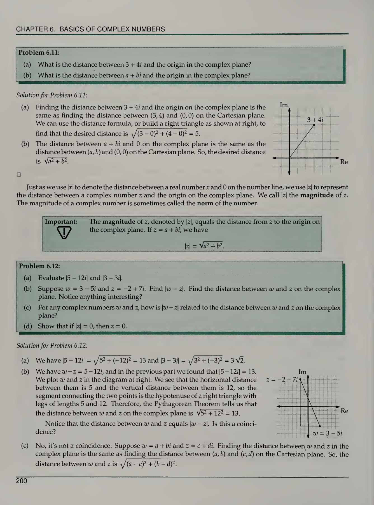
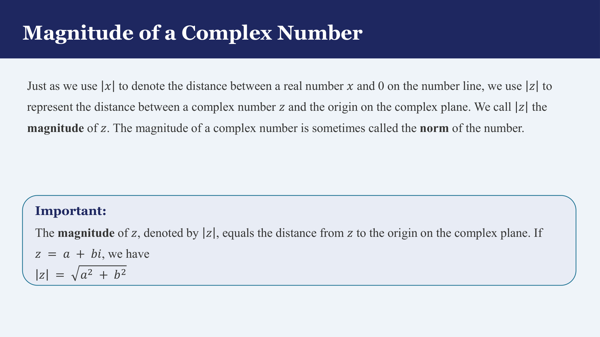
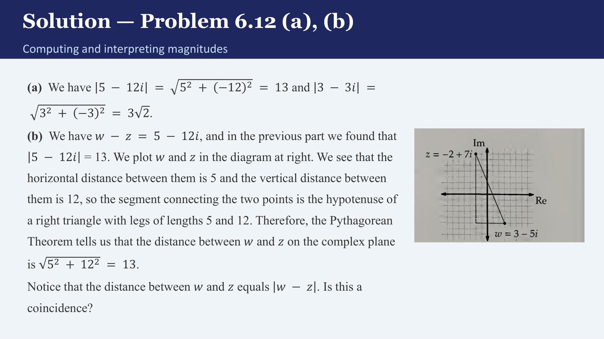
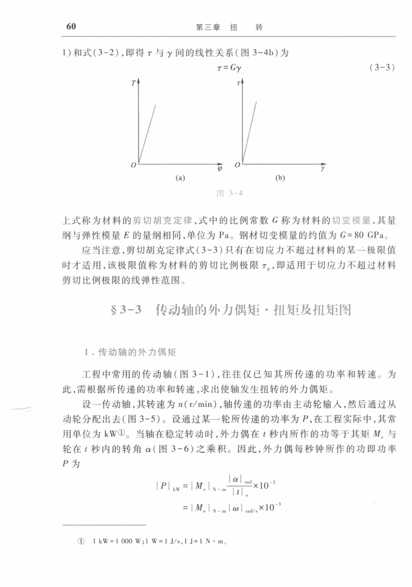
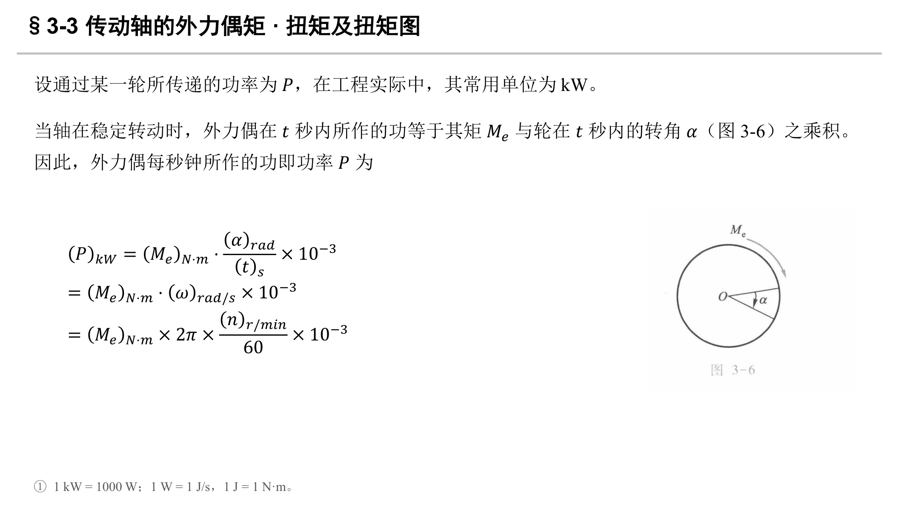

# pdf-to-pptx-omml

English | [简体中文](README.md)

[](https://github.com/GongfaChen/pdf-to-pptx-omml/releases)
[](https://github.com/GongfaChen/pdf-to-pptx-omml/actions/workflows/ci.yml)
[](LICENSE)
[](https://www.python.org/)
[](README.md)

**Turn PDF textbook chapters into slides with fully editable equations** —
equations become OMML (PowerPoint's native math objects, double-click to edit),
not screenshots, not images. Figures are located by caption and cropped at
300 dpi; layout is closed-loop audited at glyph level so nothing overlaps or
overflows.

> For: STEM textbooks and lecture notes, including **scanned pages** (AoPS /
> IB / Cambridge / Chinese university textbooks).
> Companion repo: **[back-translate-refinement](https://github.com/GongfaChen/back-translate-refinement)**
> — deterministic fidelity gates for CN→EN academic translation.

## 27-second demo

A scanned textbook page (no text layer) → a slide with native-OMML equations →
double-click, edit a value → three-gate audit before delivery:

<video src="https://github.com/user-attachments/assets/2594347c-2980-4db6-8793-b43b8eb04286" width="960" controls></video>

> 807 KB, 960×540, from a real session. Static fallback:
> [demo_workflow.gif](assets/demo_workflow.gif).

## Before / after: real textbooks

### AoPS Precalculus (p.200)

**Before** — AoPS *Precalculus* §6.2, p.200 (Problem 6.11–6.12, equations
interleaved with figures):



**After** — the same section as slides. Every equation (radicals, superscripts,
absolute values, subscripts) is native OMML:





### Chinese textbook (scanned, no text layer)

**Before** — a page from a Chinese *Mechanics of Materials* textbook (p.60, torque on
transmission shafts). The page is **scanned with no text layer** — copy-paste style
converters fail outright here:



**After** — the same section (§3-3) as a slide. The power-transmission formula
(fractions, unit subscripts, unit conventions and footnote) is native OMML:
double-click to edit, change fonts, copy into Word/LaTeX. The figure is located by
caption (Fig. 3-6) and cropped at 300 dpi. Equations on scanned pages are visually
transcribed and verified through the three-gate audit:



> Caveat: this slide is an excerpt — two transition sentences at the start of §3-3 are
> not on the slide, and the original brace notation `{P}_{kW}` is typeset as `(P)_{kW}`.
> The shear Hooke's law τ = Gγ at the top of p.60 belongs to §3-2 and is not part of
> this example.

> Textbook page screenshots are for demonstration only; copyright stays with
> the original publishers. The tool only processes files you own.

## Why this isn't "yet another PDF→PPT tool"

Existing tools turn equations into images or mojibake. This pipeline is
distilled from **45 documented pitfalls** (`references/pitfalls.md`) and
wrapped in three guard layers:

| Layer | Tool | Catches |
|---|---|---|
| API | `scripts/omml_helpers.py` | bare-text equations, empty bases, namespace drift, forbidden structures — raises at construction time |
| Static | `scripts/validate_omml.py` | unpacks the pptx and scans every slide for escaped XML / empty elements / bare text / oMathPara mixing + build-script lint |
| Render | `scripts/audit_layout.py` | glyph-level collision audit (threshold 0.40) on PowerPoint-exported PDF, content overflow, footer checks |

## Quick start

```bash
pip install -r requirements.txt      # Python 3.12+; render audit needs Windows + local PowerPoint

python demo/smoke_test.py            # builds a PPTX with every construct, verifies PowerPoint opens it
python scripts/probe_pdf.py <book.pdf> --report diagnosis.md   # read-only, free
# then follow SKILL.md: probe → crop figures → build → three-gate audit
```

## Status

- **CI**: GitHub Actions, Ubuntu × Python 3.12 / 3.13, 9 steps — OMML helper self-check,
  license self-test, source lint, build + static validation, synthetic-PDF probe, deck
  artifact upload. Green on `main` ([runs](https://github.com/GongfaChen/pdf-to-pptx-omml/actions/workflows/ci.yml)).
- **Windows + PowerPoint (real machine)**: every construct renders as Cambria Math
  glyphs with no placeholder text; the layout audit reports 0 collisions / 0 overflow.
- **Reproducible demo**: `python demo/smoke_test.py` builds a deck with all equation
  types and validates it; `scripts/probe_pdf.py` is read-only and free.
- **Repo layout**: `scripts/` (probe, OMML helpers, validators, layout audit),
  `demo/` (smoke test), `references/` (45 pitfalls + cookbook), `assets/` (screenshots).
  Full workflow: [`SKILL.md`](SKILL.md).

## Honest limits

- Equations on scanned pages are **visually transcribed**; human review is
  still required after delivery. Formula strings inside OCR text layers are
  never trusted.
- Table structure is not reconstructed (reading order is preserved instead);
  encrypted PDFs are skipped.
- The render audit depends on local PowerPoint COM. On Linux/macOS you can
  build, but **no COM means the rendering is unverified** — do not claim
  delivery. LibreOffice-class renderers are for layout previews only.

## License

MIT. `scripts/license_check.py` is a pre-wired licensing hook (pure-Python
Ed25519, RFC 8032 vectors in `--self-test`) — currently fully transparent to
users; the paid tier is an empty set.
