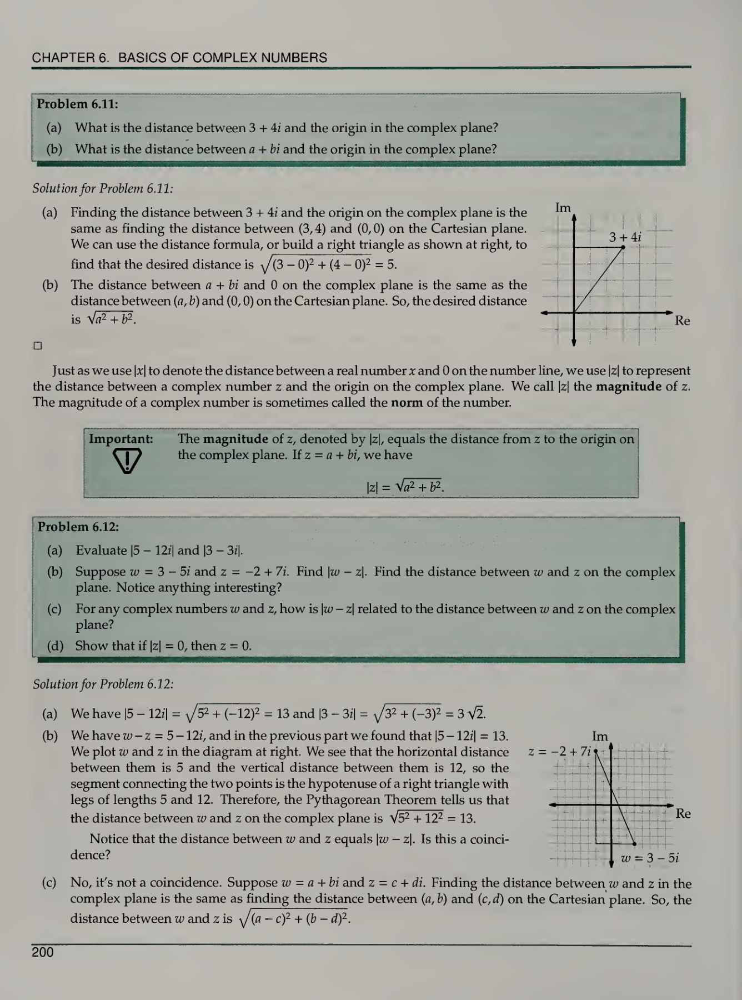
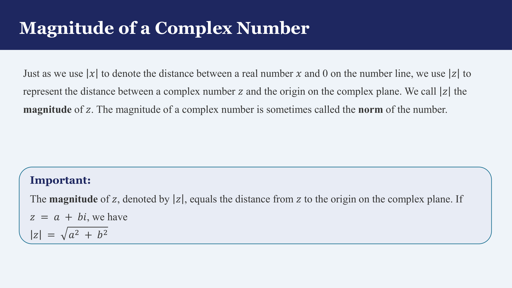
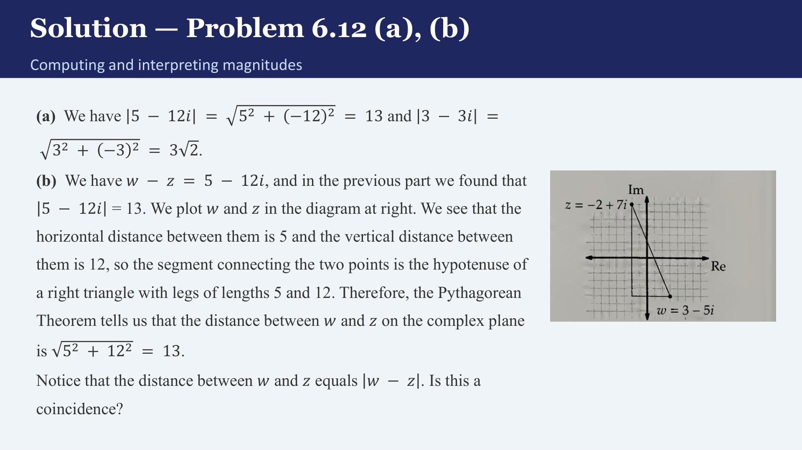

# pdf-to-pptx-omml

[](https://github.com/GongfaChen/pdf-to-pptx-omml/releases)
[](https://github.com/GongfaChen/pdf-to-pptx-omml/actions/workflows/ci.yml)
[](LICENSE)
[](https://www.python.org/)
[](README.md)

**把 PDF 教材章节变成公式完全可编辑的 PPT**——公式转 OMML（PowerPoint 原生数学对象，双击就能改），
不是截图、不是图片。图表按 caption 自动定位、300dpi 原图裁剪，版式经字形级审计闭环保证不压字、不溢出。

> 适用：AoPS / IB / Cambridge / 国内理工科教材与讲义 → 课件。
> 目标用户：高校教师、教研团队、课件制作者、辅导机构。

## 效果演示：真实教材 before / after

**Before** —— AoPS Precalculus 第 6.2 节教材原页（p.200，Problem 6.11–6.12，公式与图形混排）：



**After** —— 同一节内容提取成的课件。所有公式（根号、上标、绝对值、下标）
均为 **原生 OMML**：双击即可编辑，可改字体、可复制进 Word/LaTeX，不是截图、不是图片。





> 注：教材页面截图仅作效果展示，版权归 AoPS 所有；工具只处理用户自有的文件。

## 为什么不是"又一个 PDF 转 PPT 工具"

市面上工具把公式变成图片或乱码。本项目积累了一条 **45 条实战坑**打磨出的流水线
（`references/pitfalls.md`），并把它封装成三层护栏：

| 层 | 工具 | 拦截什么 |
|---|---|---|
| API 层 | `scripts/omml_helpers.py` | 裸文本塞公式、空基底、命名空间错位、禁用结构（m:acc / supHide）——写错当场抛异常 |
| 静态层 | `scripts/validate_omml.py` | 解包 pptx 逐 slide 扫描转义 XML / 空元素 / 裸文本 / oMathPara 混排 + 构建脚本 lint |
| 渲染层 | `scripts/audit_layout.py` | 对 PowerPoint 导出的 PDF 做字形级碰撞（阈值 0.40）、内容溢出、页脚计数三件套审计 |

公式示例（构建出来的全部是可编辑 OMML）：分数、上下标、根号、limLow 定积分、
列向量/矩阵（m:eqArr / m:m）、范数 ‖v‖、定界符。

## 快速开始

```bash
# 依赖（Python 3.9+；渲染核验需 Windows + 本机 PowerPoint）
pip install -r requirements.txt

# 1. 环境自检：构建一个含全套公式类型的 PPTX，验证 PowerPoint 能打开
python demo/smoke_test.py

# 2. 诊断你的教材（只读，免费）
python scripts/probe_pdf.py <教材.pdf> --report 诊断.md

# 3. 按 SKILL.md 工作流执行（probe → 裁图 → 构建 → 三道闸校验）
```

## 仓库结构

```
SKILL.md                  # Agent 技能主文件（工作流 + 管线判定）
requirements.txt          # 依赖（含 pywin32 的 Windows 平台标记）
scripts/
  probe_pdf.py            # PDF 可提取性诊断（只读）：文本层/扫描页/OCR 可疑/图数/公式密度/栏式
  omml_helpers.py         # OMML 构造库：T/F/S/Q/SQ/RAD/LIM/PAR/ABS/CV/MX/NORM/M + SUM/PROD/EQARR
  validate_omml.py        # 静态校验器：pptx 体检 + 源码 lint
  audit_layout.py         # 版式审计：字形碰撞 / 溢出 / 页脚三件套
  check_env.py            # 前置环境闸（只读）：依赖矩阵 + COM ProgID + 闸 2 可执行性判定
  crop_figures.py         # 裁图 CLI：xref 位图优先 / caption clip / prose 三判据 / 双栏 / 装订线
  contact_sheet.py        # 拼图：带标签 contact sheet（crop_figures.py 末尾自动调用）
  license_check.py        # 许可证钩子（Ed25519 验签，当前免费全通过，见下文）
references/
  pitfalls.md             # 45 条实战坑（按类别索引）——本仓库的核心资产
  omml-cookbook.md        # helper 用法手册与反模式清单
demo/
  smoke_test.py           # 一键环境自检
assets/                   # README 效果演示截图（before / after）
.github/
  workflows/ci.yml        # CI：self-check + lint + 构建 + 静态校验 + probe（Linux，无 COM）
  ISSUE_TEMPLATE/         # bug / feature 表单（含环境信息与自检要求）
```

## 工作流总览

```
probe 诊断 ──→ 定位章节 ──→ 裁图（xref 位图优先 / caption+clip 矢量）
                                │
                                ▼
                     build_ppt（omml_helpers 构建公式）
                                │
              ┌─────────────────┼─────────────────┐
              ▼                 ▼                 ▼
     validate check        COM 导出 PDF        contact sheet
     （静态扫低级错误）    audit 三件套审计     （目视审美兜底）
              └────── 全零后才交付 ──────┘
```

## 诚实边界

- 扫描版页的公式为**目视转录**，交付后需人工核对；OCR 文本层里的公式串一律不可信。
- 表格结构不自动还原（保证阅读顺序）；加密 PDF 不处理。
- 渲染核验依赖本机 PowerPoint（或 WPS）COM；Linux/macOS 可构建，但缺少自动审计闭环——**无 COM 即公式渲染未验收**，不得据此宣布通过或交付。LibreOffice 等只认 mc:Fallback 的渲染器仅可用于版式粗看，其导出的 PDF 禁止作为交付物。
- probe 报告只做只读诊断，不猜、不脑补提不出来的内容。

## 路线图

- [x] v0.1 开源核心：probe + OMML helper 库 + 双校验器 + 审计脚本 + 45 坑参考
- [ ] 批量章节模式（一次跑整本书，断点续跑）
- [ ] 多模板（学术蓝 / 极简黑白 / 学校 VI）
- [ ] 英文教材双语注释页自动生成
- [ ] 商业化：免费 probe + 按章付费解锁生产级流水线（支付宝 AI 付 A2M/402，评估中）

## License / 授权

代码以 MIT 开源。`scripts/license_check.py` 是为未来付费层预埋的**许可证钩子**，
当前对用户完全透明。分层用两个集合表达，切换时只改集合，不改逻辑：

| 层 | 集合 | 现在的内容 | 无 license 时的行为 |
|---|---|---|---|
| 永久免费 | `FREE_FEATURES` | `probe` | 放行 |
| 免费（开源层） | 其余非付费 feature | `core`（构建/校验/审计/裁图） | 放行 |
| 付费（预留） | `PAID_FEATURES` | **空** | 退出码 1 并提示获取 license |

- **现在**：`PAID_FEATURES` 为空，所以不放 license 也一切可用；各 CLI 入口在
  `parse_args()` 之后调用 `require_license(feature)`，无 license 时静默放行。
- **将来**：把付费 feature（如 `pipeline`）加入 `PAID_FEATURES` 即可生效；存在
  license 且公钥已配置时走严格 Ed25519 验签（签名 → 产品 → 有效期 → 功能范围）。
- **换钥**：`--generate-keys` 生成密钥对（私钥**不进仓库**）→ 替换模块内
  `PUBLIC_KEY_HEX` 后重新发布。环境变量 `PDF2PPTX_OMML_PUBKEY` **只在开发模式**
  （`PDF2PPTX_OMML_DEV=1`）生效并打印警告；发布构建会忽略它——否则任何人都能
  换成自己的公钥自签 license，付费闸形同虚设。
- **实现与性能**：纯 Python RFC 8032（零第三方依赖），实测校验 **152–163 ms/次**（约 0.16 s）；
  故意不做结果缓存——缓存文件用户可写，等于给付费闸开后门。
  全链路自检：`python scripts/license_check.py --self-test`
  （含 RFC 8032 公钥/签名向量、篡改/过期/越权、免费模式、小阶公钥拒绝）。

`license_check.py --verify` 退出码：

| 码 | 含义 |
|---|---|
| 0 | 通过（免费模式或有效 license；用 `status: FREE` / `status: OK` 区分） |
| 1 | 未找到 license 文件（免费模式，非错误）／ 付费功能被拒 |
| 2 / 3 / 4 / 5 / 6 / 7 | 签名无效 / 已过期 / 产品或功能不符 / 格式损坏 / 机器绑定不符 / 内部错误 |

> 素材说明：`assets/` 下的教材页截图版权归 AoPS 所有，仅作效果展示，**不在 MIT 授权范围内**；
> 工具本身只处理用户自有或已获授权的文件。详见 `assets/README.md`。

MIT
